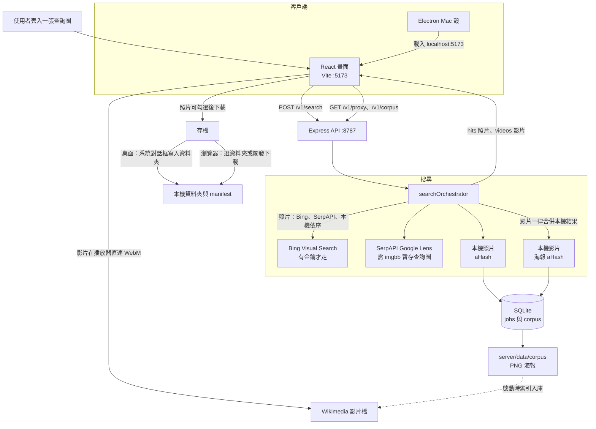

# LensQuest

以圖找圖：輸入一張圖片，搜尋視覺相關圖片，並存到你指定的路徑。

## 功能

- 上傳／拖放查詢圖
- 視覺搜尋 providers（自動選擇）
  - **Bing Visual Search**（設定 `BING_VISUAL_SEARCH_KEY`）
  - **SerpAPI Google Lens**（設定 `SERPAPI_API_KEY` + `IMGBB_API_KEY`）
  - **本機 perceptual 圖庫**（預設，無需金鑰）
- 勾選結果後下載並寫入資料夾（含 `manifest-*.json`）
- 搜尋歷史（SQLite）
- 圖片 proxy（避開瀏覽器 CORS）
- 可選 Electron 桌面殼（Mac 原生選資料夾）

## 快速開始

```bash
cp .env.example .env
npm install
npm install --prefix server
npm install --prefix app
npm run seed          # 建立本機圖庫索引（首次）
npm run dev           # API :8787 + Web :5173
```

開瀏覽器：http://localhost:5173

### 雲端搜尋（可選）

編輯 `.env`：

```bash
BING_VISUAL_SEARCH_KEY=your_azure_bing_key
# 或
SERPAPI_API_KEY=your_serpapi_key
IMGBB_API_KEY=your_imgbb_key
SEARCH_PROVIDER=auto
```

### Mac 桌面版

先啟動 `npm run dev`，另開終端：

```bash
npm install --prefix desktop
npm run desktop
```

桌面版可用系統對話框選資料夾並直接寫檔。

## 系統架構



## 專案結構

```text
app/        React UI（Vite）
server/     Express API + SQLite + providers
desktop/    Electron shell
docs/       架構與 roadmap
```

## API

| Method | Path | 說明 |
| --- | --- | --- |
| GET | `/v1/health` | 健康檢查與 providers |
| POST | `/v1/search` | multipart `image` + `maxResults`/`minScore` |
| GET | `/v1/jobs/:id` | 查詢 job |
| GET | `/v1/history` | 搜尋歷史 |
| GET | `/v1/proxy?url=` | 圖片 proxy |

## 驗證

```bash
npm run build
npm test
```

更多設計見 [docs/ARCHITECTURE.md](docs/ARCHITECTURE.md)。
